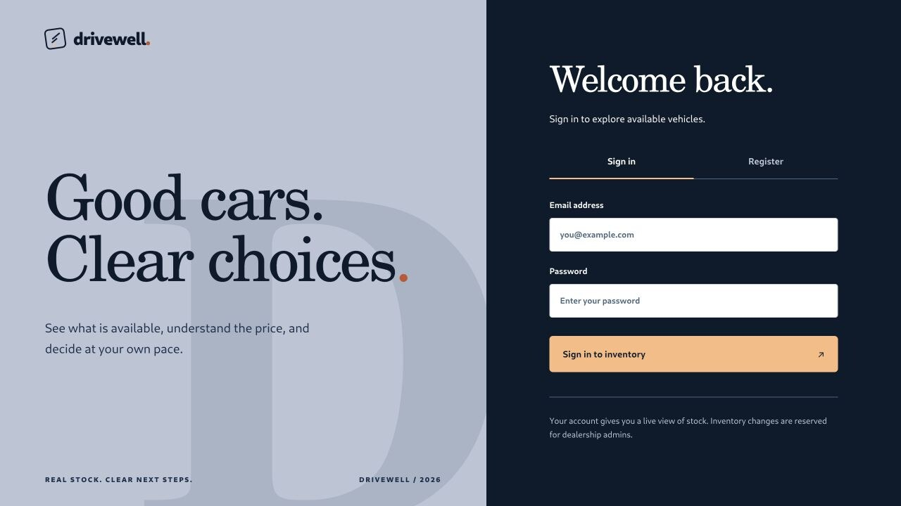
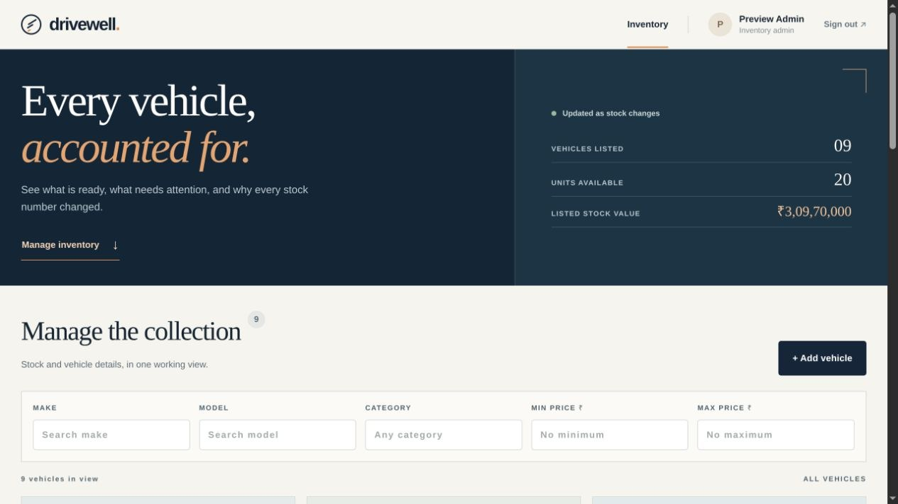
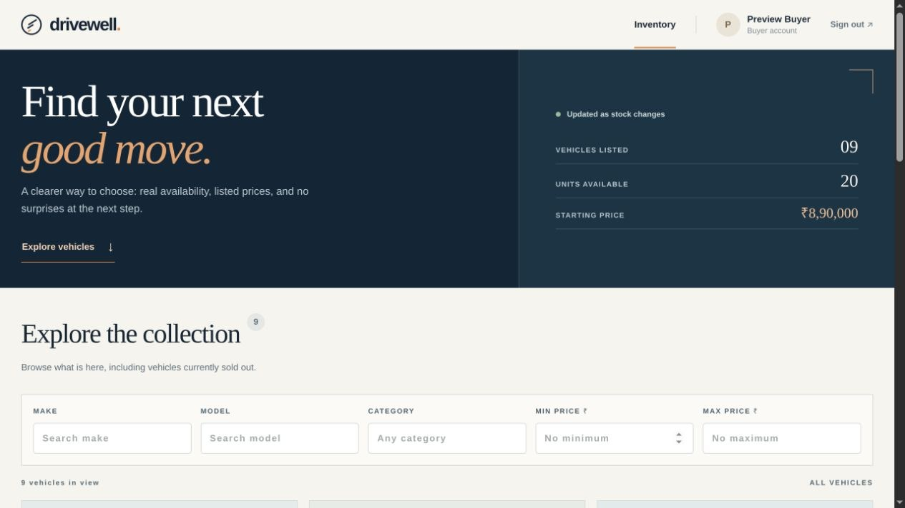
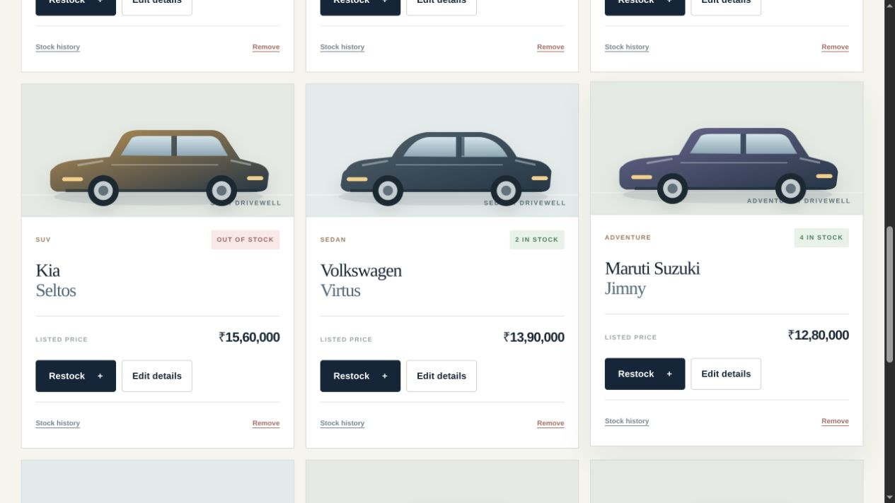
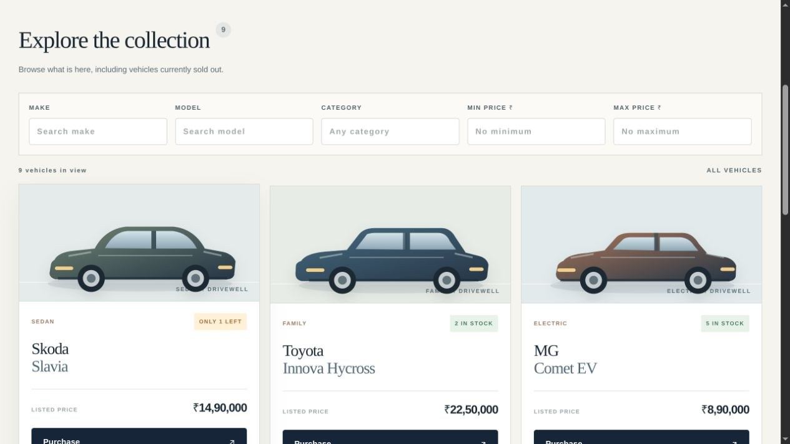
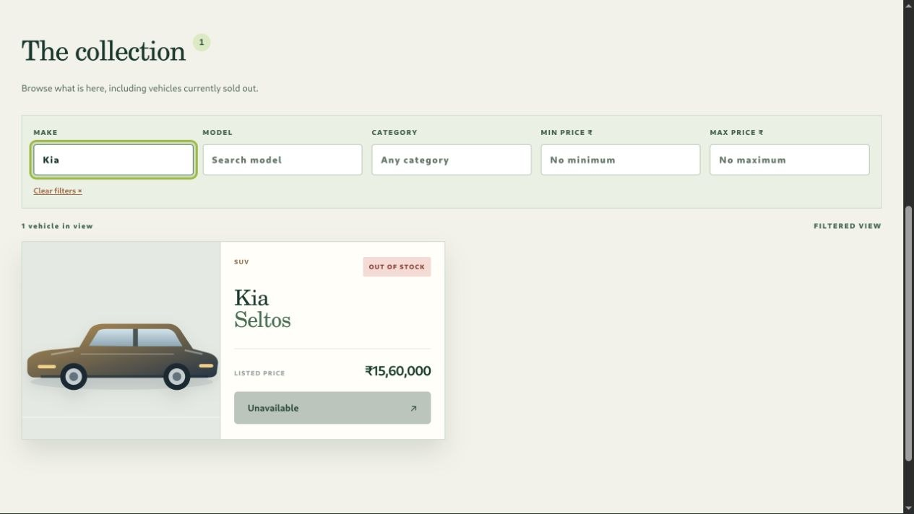
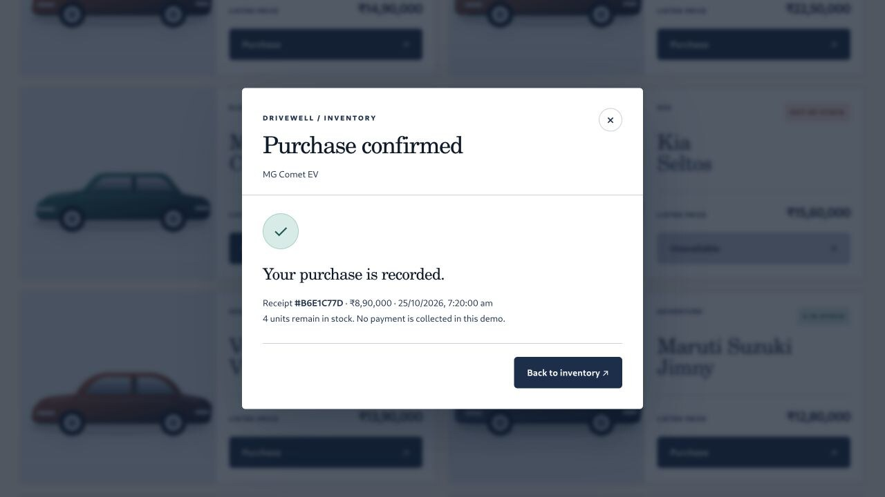

# Drivewell

A full-stack car dealership inventory that makes stock status easy to understand and safe to change. Buyers can register, search, and record a purchase. Inventory admins can manage vehicles, restock them, and inspect the stock history behind each number.

The app uses **React, HTML5, CSS3, and Tailwind CSS** on the frontend, with a **Node.js/TypeScript Express API** and persistent **SQLite** database. The visual design and car illustrations were created for this project; no UI code or assets were copied from another repository.

## What you can do

| Buyer | Inventory admin |
| --- | --- |
| Register and sign in | Sign in with a configured admin account |
| Browse vehicles, including out-of-stock listings | Add, edit, and remove vehicles |
| Search by make, model, category, and price range | Restock and inspect stock history |
| Purchase an in-stock vehicle and receive a receipt | See the same live inventory totals as buyers |

A purchase records an inventory change and reduces stock by one. **This demo does not collect payment or create a real sales contract.** Demo vehicle prices are illustrative.

## Screenshots















## Run locally

You need **Node.js 24 or newer** and **pnpm 11**. The built-in `node:sqlite` module means no separate database server is needed.

```bash
cp .env.example .env
pnpm install
pnpm dev
```

Before starting, edit `.env`:

- Replace `JWT_SECRET` with a long random value (at least 24 characters).
- Set `ADMIN_EMAIL` and a private `ADMIN_PASSWORD` for the initial admin account. Public registration always creates a buyer.
- Restart the app after changing `ADMIN_PASSWORD` in `.env`; the configured password is synchronized with the existing admin account on startup.
- Leave `SEED_DEMO=true` to load nine illustrative vehicles on an empty database, or set it to `false` to start empty.

Open **http://localhost:5173**. The development frontend proxies `/api` to the API at **http://localhost:3001**. The SQLite file is created at `DATABASE_PATH` (default `./data/inventory.db`) and is ignored by Git. `SEED_DEMO` only adds vehicles when the database has never contained a vehicle. Remove the local database file if you want a fresh demo.

To run the production build from one server:

```bash
pnpm build
pnpm start
```

Open **http://localhost:3001**. The Express server serves the built SPA and API together. A production host needs persistent disk for the SQLite file and environment variables for `JWT_SECRET`, admin credentials, and optionally `PORT`.

### Run tests

```bash
pnpm test
pnpm exec vitest run --coverage
pnpm build
```

The current results and coverage are in [TEST_REPORT.md](TEST_REPORT.md). GitHub Actions runs the suite and build for every push and pull request.

## API

Send the token from registration or login as `Authorization: Bearer <token>`. All vehicle endpoints require authentication. Admin-only endpoints are marked below.

| Method | Path | Purpose |
| --- | --- | --- |
| POST | `/api/auth/register` | Create a buyer account |
| POST | `/api/auth/login` | Sign in |
| GET | `/api/auth/me` | Check the current session |
| GET | `/api/vehicles` | List active vehicles, including zero-stock vehicles |
| GET | `/api/vehicles/search` | Filter by `make`, `model`, `category`, `minPrice`, `maxPrice` |
| POST | `/api/vehicles` | Add a vehicle (admin) |
| PUT | `/api/vehicles/:id` | Update complete vehicle details (admin) |
| DELETE | `/api/vehicles/:id` | Remove from active inventory (admin) |
| POST | `/api/vehicles/:id/purchase` | Purchase one unit; returns a receipt |
| POST | `/api/vehicles/:id/restock` | Add a positive `quantity` (admin) |
| GET | `/api/vehicles/:id/history` | View stock events (admin) |

Vehicle input example:

```json
{ "make": "Tata", "model": "Nexon EV", "category": "Electric SUV", "price": 1420000, "quantity": 3 }
```

`price` is a positive whole number in INR for this demo. Inventory updates are validated. Purchases use a conditional SQLite update inside a transaction, so concurrent requests cannot both buy the final unit. Stock events record initial quantity, purchases, restocks, and adjustments. Removing a vehicle hides it from the active list while retaining its history in the database.

## Engineering choices

- **Test-first core:** The Git history has separate failing test and passing implementation commits for authentication and inventory. The tests cover role boundaries, validation, search, the final-unit race, stock history, and persistence across restart.
- **Small deployment surface:** Express serves the compiled React app and API from one process. SQLite is a real persistent database with no extra service to configure for this kata.
- **Clear operational state:** A sold-out car stays visible with its purchase button disabled. Confirmation repeats the listed price and rechecks stock. Admins can see *why* the count changed.
- **Honest demo boundaries:** The app records inventory purchases, but does not pretend to process payments. Sample prices are labeled illustrative.

The stock history and guarded final-unit purchase are deliberately practical additions. They address the moments where a dealership employee or buyer needs trust in the number on the screen. The interface uses plain labels, visible availability, clear confirmation, and recovery messages so the system feels considerate rather than decorative.

### Design choices

- The inventory summary and search sit near the top so a buyer or employee can get to the current stock quickly. The buyer sees the lowest price among vehicles actually in stock; the admin sees the listed value of available units.
- The same card answers different questions by role. Buyers see an available purchase action or a clear unavailable state. Admins see restock and edit first, with stock history and removal as separate decisions.
- Category-based illustrations give the collection character without implying that they are photos of the exact listed cars. Stock counts and prices remain text rather than information carried only by color or decoration.
- The language stays honest: a purchase records stock and a receipt in this demo, and the confirmation says no payment is taken.

## My AI Usage

I used **OpenAI Codex (GPT-6)** extensively as a development partner for this assignment. I supplied the assignment, job description, deadline, privacy constraints, and a direction to build something distinctive and human-centered. Codex helped map requirements, draft tests and implementation, design the original interface, debug the browser workflow, and write documentation. The Git commits that contain AI-assisted work carry a `Co-authored-by` trailer.

The tests and browser review were important checks on the generated work. They exposed details that needed correction, including totals that initially followed the filtered list, purchase copy that could imply payment was taken, and an adventure vehicle drawn with a sedan silhouette. Those were changed before submission. AI made it possible to cover the full stack quickly, but it did not remove the need to check behavior, state the limits clearly, and understand the tradeoffs. I would explain the SQLite choice, role model, conditional purchase update, test history, and UI decisions in an interview.

The required raw AI conversation record or public chat link is in [PROMPTS.md](PROMPTS.md). The assignment PDF and job description stay outside this repository; the local handover note is Git ignored.
