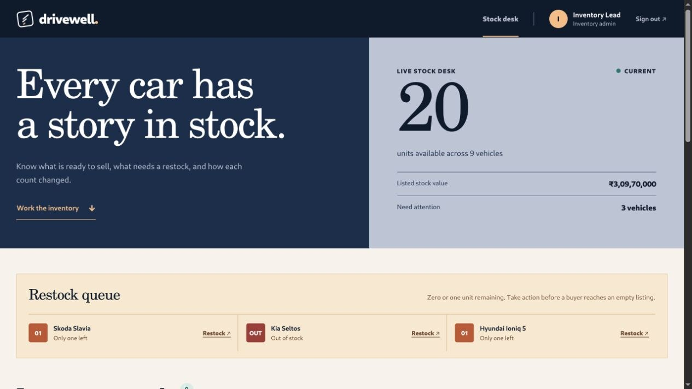
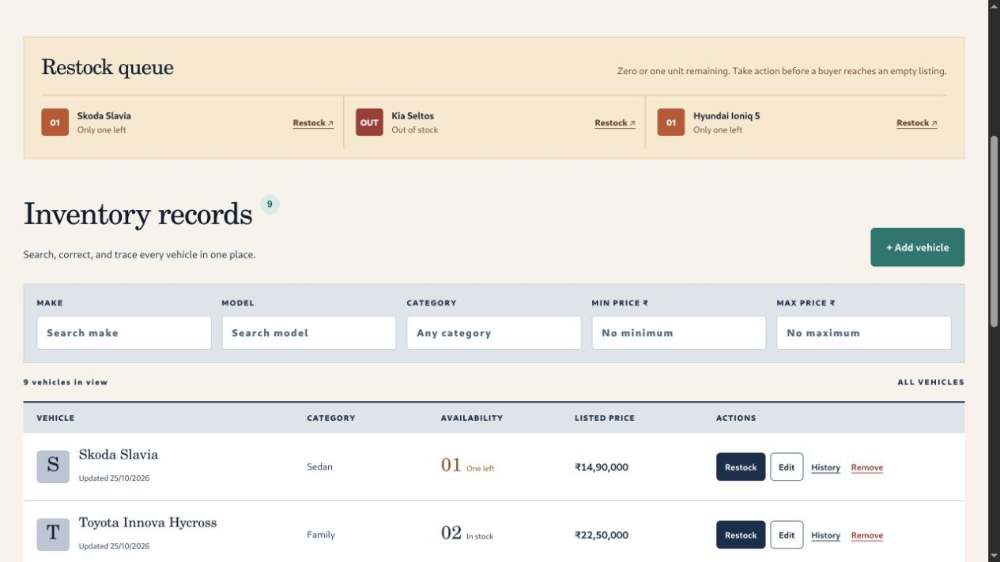
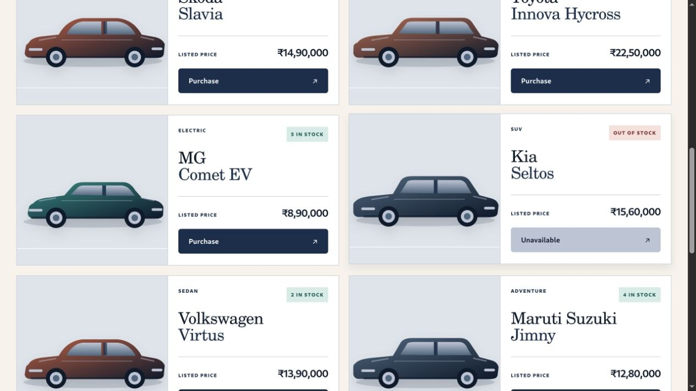
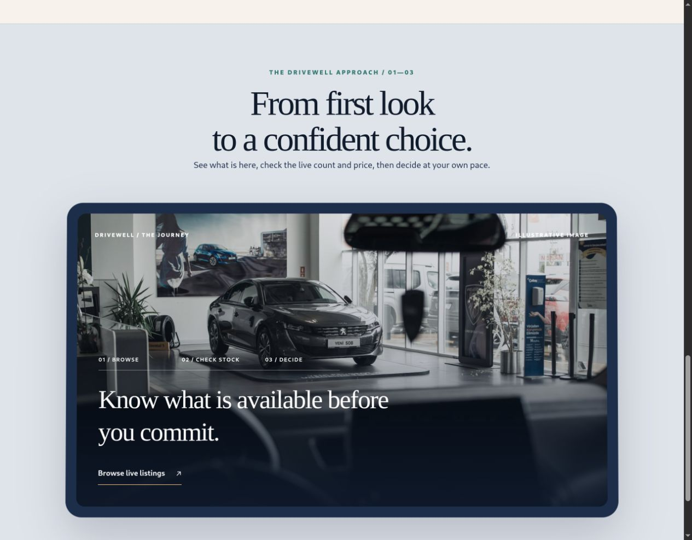
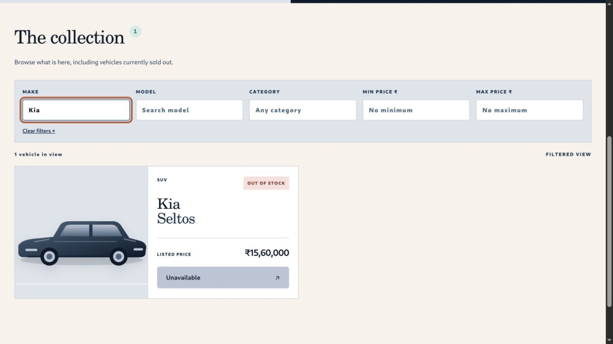

# Drivewell

A full-stack car dealership inventory that makes stock status easy to understand and safe to change. Buyers can register, search, and record a purchase. Inventory admins can manage vehicles, restock them, and inspect the stock history behind each number.

The app uses **React, HTML5, CSS3, and Tailwind CSS** on the frontend, with a **Node.js/TypeScript Express API** and persistent **SQLite** database. The visual design and car illustrations were created for this project. A credited Unsplash photo appears only in the buyer's scroll story; it does not depict a listed vehicle.

## What you can do

| Buyer | Inventory admin |
| --- | --- |
| Register and sign in | Sign in with a configured admin account |
| Browse vehicles, including out-of-stock listings | Add, edit, and remove vehicles |
| Search by make, model, category, and price range | Restock and inspect stock history |
| Purchase an in-stock vehicle and receive a receipt | See the same live inventory totals as buyers |

A purchase records an inventory change and reduces stock by one. **This demo does not collect payment or create a real sales contract.** Demo vehicle prices are illustrative.

## Screenshots

Captured from the running app with seeded demo inventory and disposable preview accounts. The receipt shows a test purchase; no payment was taken.














## Run locally

You need **Node.js 24 or newer** and **pnpm 11**. The built-in `node:sqlite` module means no separate database server is needed.

```bash
cp .env.example .env
pnpm install
pnpm dev
```

Before starting, edit `.env`:

- Replace `JWT_SECRET` with a long random value (at least 24 characters).
- Set `ADMIN_EMAIL` and a private `ADMIN_PASSWORD` for the initial admin account. Public registration always creates a buyer.
- Restart the app after changing `ADMIN_PASSWORD` in `.env`; the configured password is synchronized with the existing admin account on startup.
- Leave `SEED_DEMO=true` to load nine illustrative vehicles on an empty database, or set it to `false` to start empty.

Open **http://localhost:5173**. The development frontend proxies `/api` to the API at **http://localhost:3001**. The SQLite file is created at `DATABASE_PATH` (default `./data/inventory.db`) and is ignored by Git. `SEED_DEMO` only adds vehicles when the database has never contained a vehicle. Remove the local database file if you want a fresh demo.

To run the production build from one server:

```bash
pnpm build
pnpm start
```

Open **http://localhost:3001**. The Express server serves the built SPA and API together. A production host needs persistent disk for the SQLite file and environment variables for `JWT_SECRET`, admin credentials, and optionally `PORT`.

### Deploy with persistent SQLite

The root `Dockerfile` builds the React app and runs the Express API in one service. On a container host that supports a persistent volume:

1. Build from this repository's `main` branch using the Dockerfile. Expose the app's HTTP port (default `3001`, or set `PORT` to the host's assigned port).
2. Attach one persistent volume at `/data` and set `DATABASE_PATH=/data/inventory.db`. This keeps the SQLite file and its WAL files across restarts and deploys. Run a single app instance against that volume.
3. Set private runtime variables: a new random `JWT_SECRET` of at least 24 characters, `ADMIN_EMAIL`, `ADMIN_PASSWORD`, and optionally `ADMIN_NAME`. Set `SEED_DEMO=true` to load nine illustrative vehicles only if the database is empty. Do not publish these credentials or reuse the local `.env` password.
4. Configure an HTTP health check at `/api/health`. Once the host provides a public domain, verify sign-in, registration, inventory, and a restart before sharing the link.

A host with only temporary filesystem storage will lose users and inventory when it restarts, so its default storage is unsuitable for this app. The app records inventory purchases only; it takes no payment.

### Run tests

```bash
pnpm test
pnpm exec vitest run --coverage
pnpm build
```

The current results and coverage are in [TEST_REPORT.md](TEST_REPORT.md). GitHub Actions runs the suite and build for every push and pull request.

## API

Send the token from registration or login as `Authorization: Bearer <token>`. All vehicle endpoints require authentication. Admin-only endpoints are marked below.

| Method | Path | Purpose |
| --- | --- | --- |
| POST | `/api/auth/register` | Create a buyer account |
| POST | `/api/auth/login` | Sign in |
| GET | `/api/health` | Confirm the API can read its database |
| GET | `/api/auth/me` | Check the current session |
| GET | `/api/vehicles` | List active vehicles, including zero-stock vehicles |
| GET | `/api/vehicles/search` | Filter by `make`, `model`, `category`, `minPrice`, `maxPrice` |
| POST | `/api/vehicles` | Add a vehicle (admin) |
| PUT | `/api/vehicles/:id` | Update complete vehicle details (admin) |
| DELETE | `/api/vehicles/:id` | Remove from active inventory (admin) |
| POST | `/api/vehicles/:id/purchase` | Purchase one unit; returns a receipt |
| POST | `/api/vehicles/:id/restock` | Add a positive `quantity` (admin) |
| GET | `/api/vehicles/:id/history` | View stock events (admin) |

Vehicle input example:

```json
{ "make": "Tata", "model": "Nexon EV", "category": "Electric SUV", "price": 1420000, "quantity": 3 }
```

`price` is a positive whole number in INR for this demo. Inventory updates are validated. Purchases use a conditional SQLite update inside a transaction, so concurrent requests cannot both buy the final unit. Stock events record initial quantity, purchases, restocks, and adjustments. Removing a vehicle hides it from the active list while retaining its history in the database.

## Engineering choices

- **Test-first core:** The Git history has separate failing test and passing implementation commits for authentication and inventory. The tests cover role boundaries, validation, search, the final-unit race, stock history, and persistence across restart.
- **Small deployment surface:** Express serves the compiled React app and API from one process. SQLite is a real persistent database with no extra service to configure for this kata.
- **Clear operational state:** A sold-out car stays visible with its purchase button disabled. Confirmation repeats the listed price and rechecks stock. Admins can see *why* the count changed.
- **Honest demo boundaries:** The app records inventory purchases, but does not pretend to process payments. Sample prices are labeled illustrative.

The stock history and guarded final-unit purchase are deliberately practical additions. They address the moments where a dealership employee or buyer needs trust in the number on the screen. The interface uses plain labels, visible availability, clear confirmation, and recovery messages so the system feels considerate rather than decorative.

### Design choices

- The header places the Drivewell mark near the left edge and account controls near the right edge, leaving the center clear at wide widths. Midnight Blue (`#1C2E4A`), Dusty Blue (`#52677D`), Ivory (`#BDC4D4`), and Deep Navy (`#0F1A2B`) anchor the palette. Apricot draws attention to primary actions, sea-glass marks available stock, and warm amber and rose distinguish low and empty stock.
- The buyer showroom and admin stock desk have different layouts because their jobs are different. Buyers see a featured car with the lowest in-stock price and browse horizontal vehicle cards. Admins get a compact stock ledger, live totals, and a restock queue for cars with zero or one unit left.
- Search remains available in both views. Sold-out listings stay visible to buyers with the purchase action disabled; admins can restock, edit, trace stock history, or remove a listing from the ledger.
- Category-based illustrations give the collection character without implying that they are photos of the exact listed cars. Stock counts and prices remain text rather than information carried only by color or decoration.
- The language stays honest: a purchase records stock and a receipt in this demo, and the confirmation says no payment is taken.
- After the buyer's collection, a restrained scroll animation shows a three-step path from browsing to a decision. It respects reduced-motion settings and keeps search and purchase controls above it. The photo is marked illustrative so it cannot be mistaken for an inventory listing.

### UI component setup

This Vite app already has TypeScript and Tailwind CSS. Shared UI components live in `src/components/ui`, with `@/` mapped to `src` in the TypeScript and Vite configurations. The scroll component is at `src/components/ui/container-scroll-animation.tsx` and uses `framer-motion`; its Drivewell example is at `src/components/ShowroomScrollStory.tsx`. Vite uses a normal `` for the local photo rather than Next.js `Image`.

The `src/components/ui` folder is the equivalent of `/components/ui` in a source-root Vite project. Keeping reusable components there makes the `@/components/ui/...` imports in examples and the shadcn CLI's default UI alias resolve to one place. Copy-pasted components do not need `components.json`; if you later want to install registry components with the CLI, run `pnpm dlx shadcn@latest init` from this repository and select the existing `src/components/ui` path. The project's base styles are in `src/styles.css`, followed by layout rules in `src/redesign.css` and palette rules in `src/palette.css`.

## My AI Usage

I used **OpenAI Codex (GPT-6)** extensively as a development partner for this assignment. I supplied the assignment, job description, deadline, privacy constraints, and a direction to build something distinctive and human-centered. Codex helped map requirements, draft tests and implementation, design the original interface, debug the browser workflow, and write documentation. The Git commits that contain AI-assisted work carry a `Co-authored-by` trailer.

The tests and browser review were important checks on the generated work. They exposed details that needed correction, including totals that initially followed the filtered list, purchase copy that could imply payment was taken, and an adventure vehicle drawn with a sedan silhouette. The first UI pass still looked too similar to the original; after feedback, I gave buyers and admins separate visual workflows. AI made it possible to cover the full stack quickly, but it did not remove the need to check behavior, state the limits clearly, and understand the tradeoffs. I would explain the SQLite choice, role model, conditional purchase update, test history, and UI decisions in an interview.

The required raw AI conversation record or public chat link is in [PROMPTS.md](PROMPTS.md). The assignment PDF and job description stay outside this repository; the local handover note is Git ignored.
